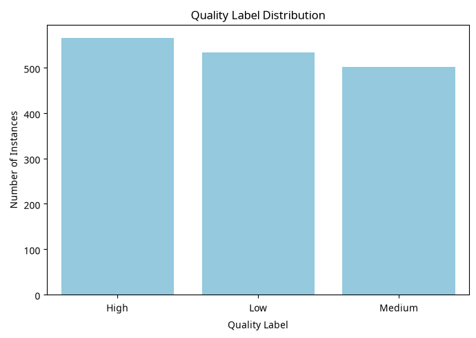
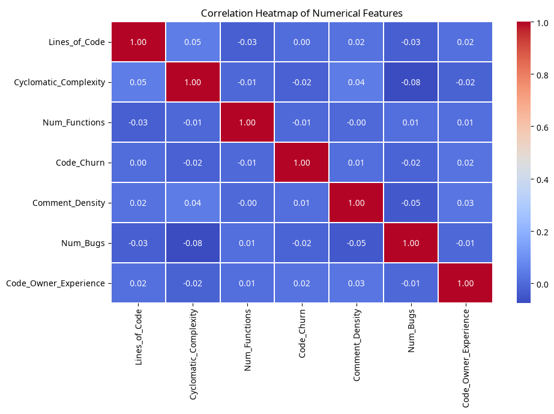
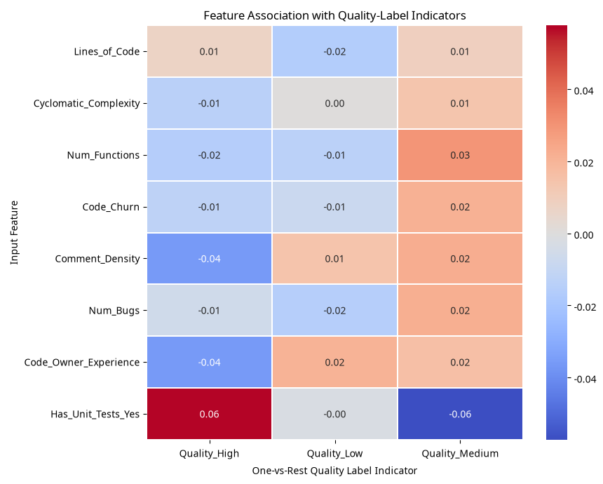
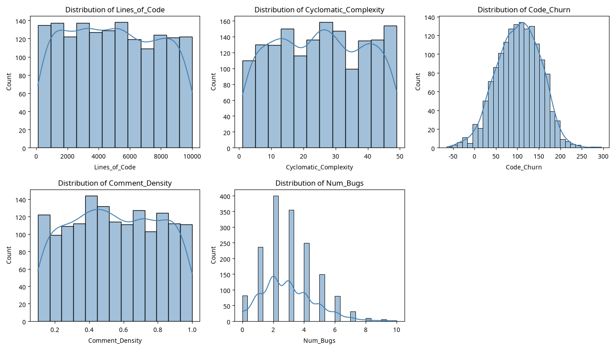
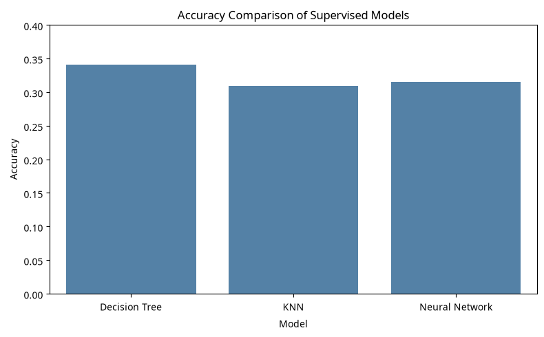
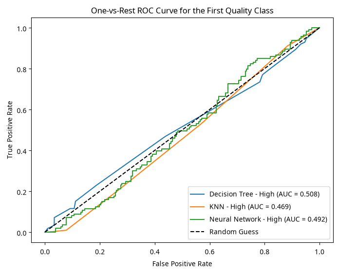
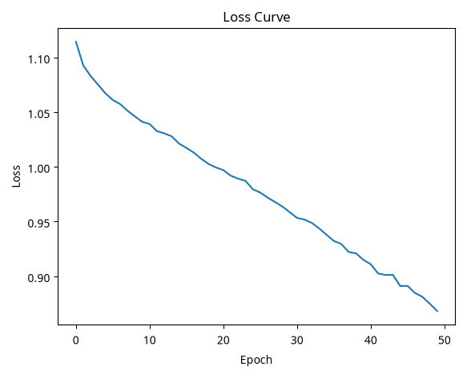
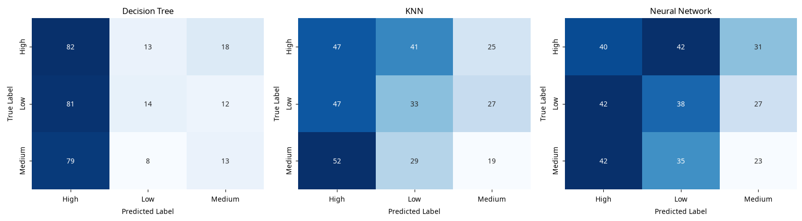
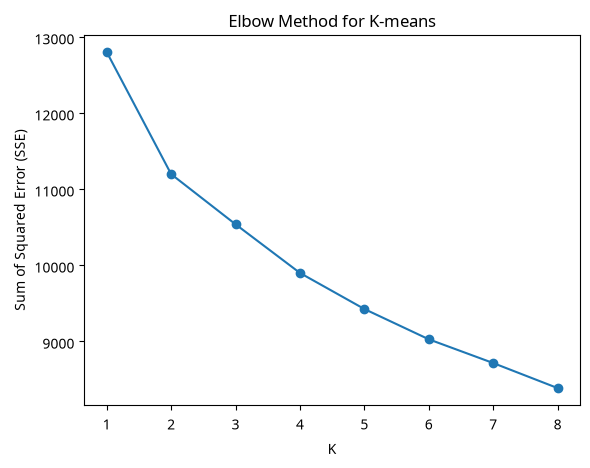
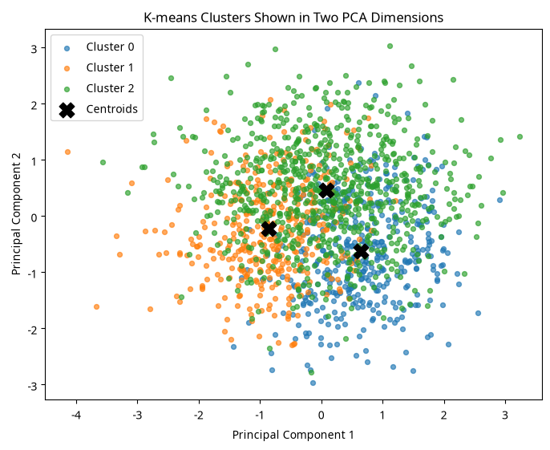

# Predicting Software Quality from Source Code Metrics

A multiclass classification and unsupervised clustering study built for **CSE422 (Artificial Intelligence)** using `software_quality_dataset.csv`. The project evaluates **Decision Tree**, **K-Nearest Neighbors (KNN)**, a **Keras Neural Network**, and **K-means Clustering** across 1,600 software modules, paired with a full 21-page technical report.

- **Notebook:** [`Predicting_Software_Quality_from_Source_Code_Metrics_.ipynb`](./Predicting_Software_Quality_from_Source_Code_Metrics_.ipynb)
- **Full Report:** [`Lab Project Report.pdf`](./Lab%20Project%20Report.pdf)
- **Dataset:** [`software_quality_dataset.csv`](./software_quality_dataset.csv)

---

## Dataset Overview

`software_quality_dataset.csv` contains **1,600 rows** and **9 columns** (0 duplicate rows): **8 input features** (7 numeric, 1 binary categorical) and a balanced 3-class target (`Quality_Label`).

| Column | Type | Details | Missing Values |
| :--- | :--- | :--- | :--- |
| `Lines_of_Code` | `float64` | Module size in lines (106 – 9,998) | 80 (5.0%) |
| `Cyclomatic_Complexity` | `int64` | Independent control-flow paths (1 – 49) | 0 |
| `Num_Functions` | `int64` | Functions defined in the module (5 – 199) | 0 |
| `Code_Churn` | `float64` | Recent change volume (-64.28 – 295.14) | 80 (5.0%) |
| `Comment_Density` | `float64` | Fraction of comment lines (0.101 – 1.000) | 80 (5.0%) |
| `Num_Bugs` | `int64` | Recorded bugs (0 – 10) | 0 |
| `Has_Unit_Tests` | `object` | Binary categorical (`Yes` / `No`) | 0 |
| `Code_Owner_Experience` | `int64` | Owner experience level (1 – 9) | 0 |
| **`Quality_Label`** *(Target)* | `object` | `High` (566 / 35.38%), `Low` (533 / 33.31%), `Medium` (501 / 31.31%) | 0 |

---

## Exploratory Data Analysis

The three target classes are nearly balanced (**uniform-random baseline = 33.33%**), and Pearson/Spearman/Kendall correlations between every input feature and `Quality_Label` are near zero.

| Class Distribution | Feature Correlations | Target Associations |
| :---: | :---: | :---: |
|  |  |  |

<details>
<summary>View numeric feature distributions plot</summary>



</details>

---

## Preprocessing Pipeline

1. **Median Imputation:** Filled 5% missing values in `Lines_of_Code` (median `4860.0`), `Code_Churn` (`104.0075`), and `Comment_Density` (`0.5421`) using `SimpleImputer(strategy='median')` rather than dropping ~15% of rows.
2. **Label Encoding:** Encoded `Has_Unit_Tests` (`No` → `0`, `Yes` → `1`) and `Quality_Label` (`High` → `0`, `Low` → `1`, `Medium` → `2`) via `LabelEncoder`.
3. **Train / Test Split:** 80/20 split (`1,280` training rows, `320` test rows, `random_state=42`).
4. **Leak-Free Scaling:** `StandardScaler` was fitted strictly on `X_train` and applied to `X_test` for distance- and gradient-based models (**KNN**, **Neural Network**, **K-means**), while the **Decision Tree** was trained on unscaled features.

---

## Models & Results

### Supervised Classification Comparison (`320`-Row Test Set)

| Model | Configuration | Test Accuracy | Macro Precision | Macro Recall | Macro F1 | Macro AUC |
| :--- | :--- | :---: | :---: | :---: | :---: | :---: |
| **Decision Tree** | `max_depth=5`, Gini, unscaled | 33.44% | 22.87% | 32.24% | 26.31% | 0.477 |
| **KNN** | `n_neighbors=5`, scaled (after `k=1..20` scan) | 33.44% | 32.57% | 32.62% | 32.43% | 0.503 |
| **Neural Network** | `8 → 32 (ReLU) → 16 (ReLU) → 3 (Softmax)`, 867 params, Adam (`lr=0.001`), 50 epochs | 30.63% | 30.48% | 30.92% | 30.44% | 0.484 |

*(An unconstrained Decision Tree reaches depth 25 with 477 leaves and 100.00% training accuracy, but drops to 32.19% on the test set—confirming memorization rather than generalizable signal.)*

| Accuracy Comparison | ROC Comparison | Neural Network Loss Curve |
| :---: | :---: | :---: |
|  |  |  |



### Unsupervised Clustering (`K-means`)

- Applied `KMeans(n_clusters=3, random_state=42, n_init=10)` on all 1,600 scaled feature rows (ignoring labels) after inspecting SSE across `K = 1..10` via the Elbow method.
- **Cluster Sizes (`K=3`):** Cluster 0 = `429`, Cluster 1 = `392`, Cluster 2 = `779` (`Inertia / SSE = 10,536.73`).

| Elbow Method (`K` Selection) | PCA Projection of K-means Clusters |
| :---: | :---: |
|  |  |

---

## Key Findings

- **Statistical Independence:** All three supervised models perform near the **33.33% random-guess baseline** with **Macro AUC ≈ 0.50**, and the Neural Network's training loss drops while validation loss diverges—proving the eight source-code metrics carry no predictive signal for `Quality_Label` in this synthetic dataset (also evidenced by uniform feature distributions and negative `Code_Churn` values).
- **Methodological Rigor:** Instead of tuning hyperparameters on the test set to chase a noisy accuracy spike, this study establishes clear baselines and corroborates the absence of signal via correlation tests, learning curves, ROC/AUC, and unsupervised clustering.

---

## Project Structure

```text
CSE422 Project/
├── Predicting_Software_Quality_from_Source_Code_Metrics_.ipynb
├── software_quality_dataset.csv
├── Lab Project Report.pdf
├── CSE422 Project Guidelines.pdf
├── plots/
│   ├── accuracy_comparison.png
│   ├── class_distribution.png
│   ├── confusion_matrices.png
│   ├── correlation_heatmap.png
│   ├── kmeans_diagnostics.png
│   ├── kmeans_pca_clusters.png
│   ├── neural_network_loss.png
│   ├── numeric_distributions.png
│   ├── roc_comparison.png
│   └── target_association_heatmap.png
└── README.md
```

---

## Running Locally

1. Install Python dependencies:
   ```bash
   pip install numpy pandas matplotlib seaborn scikit-learn tensorflow jupyter
   ```
2. Open and run the notebook from this folder:
   ```bash
   jupyter notebook Predicting_Software_Quality_from_Source_Code_Metrics_.ipynb
   ```
